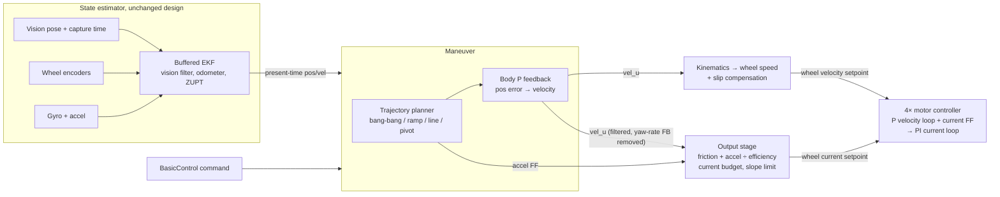

# Robot Motion Controller: Design, Calibration and Re-implementation Guide

This report describes the body motion controller on `dev/nick/model-search`
(firmware, `controls` and `software-communication` submodules, and the ROS
`software` repo on the same branch name). It covers:

1. The controller architecture: feed-forward, feedback and supervision.
2. How each parameter was identified and calibrated on robot 2.
3. Where the design follows TIGERs Mannheim's open-source firmware, where it
   differs, and why.
4. A step-by-step methodology for re-implementing and re-tuning it from
   scratch.

All numbers are from robot 2 on our carpet in November 2026 unless noted.

---

## 1. Summary

The robot uses a **feed-forward-first** controller that runs at 1 kHz on the
control board, with two feedback loops:

- **Wheel current feed-forward** (torque) carries almost all of the force the
  robot needs to follow its trajectory: friction compensation plus
  acceleration, divided by an output efficiency.
- **Body feedback** is proportional only. It adds a position-error correction to
  the commanded body **velocity**, never to the acceleration.
- **Wheel feedback** is a P-only velocity loop on each motor controller. It
  turns that velocity command into extra current and corrects whatever the
  feed-forward model misses.

The structure, the friction model's form and most gains come from TIGERs
Mannheim (`ctrl_panthera.c`, `model_fric.c`, `robot_impl.c`). The main
differences come from our hardware:

- Our motors are smaller: a 50 W DF45M024053-A2, rated 2.36 A continuous and
  7 A peak.
- Our friction is relatively higher, about 2× TIGERs' Coulomb term.
- Our robot is tethered during development.
- The estimator and radio path are different.

---

## 2. Signal flow



Code locations (firmware repo):

| Block | File |
|---|---|
| Per-tick orchestration, output stage | `control-board/src/motion/body_controller.rs` |
| Trajectory tracking, body feedback, capability cap, radio params | `control-board/src/motion/control_context.rs` |
| Maneuvers (position, velocity, line, pivot, accel) | `control-board/src/motion/maneuvers/` |
| Velocity-mode ramp | `control-board/src/motion/velocity_ramp.rs` |
| Thermal budget | `control-board/src/motion/wheel_thermal.rs` |
| Controller constants | `control-board/src/motion/params/controller_params.rs` |
| Friction/efficiency model, kinematics | `controls/ateam-controls/src/robot_model.rs` |
| Physical, estimator and trajectory defaults | `controls/ateam-controls/src/defaults.rs` |
| State estimator | `controls/ateam-controls/src/state_estimation.rs` |
| Wheel motor firmware (velocity loop, limits) | `motor-controller/bin/wheel-torque/`, `motor-controller/common/6step_current.c` |
| Calibration and test scripts | `controls/analysis/calibration/`, `controls/analysis/ros_scripts/` |

---

## 3. Controller design

### 3.1 Reference: trajectory planner

Each maneuver plans a trajectory every tick from the current state, giving the
trajectory position `p_traj`, velocity `v_traj` and acceleration `a_traj`.

- **Position mode** (`global_position.rs`):
  - Plans a 3-axis bang-bang trajectory (x, y, θ), with the XY axes
    synchronized so they arrive together.
  - Replans when the (filtered) target changes. The seed is the current
    trajectory sample, so the hand-off is continuous.
  - Restarts from the estimate when XY tracking error exceeds
    `TRAJ_RESET_ERROR_XY` = 0.10 m.
- **Heading-target lag** (`OrientTargetLag`): heading target changes smaller
  than 0.05 rad pass through a first-order low-pass with T = 0.1 s, and larger
  jumps pass through unfiltered. Without it, a streamed heading target with
  noise replans a fresh full-acceleration angular profile every packet.
- **Feed-forward acceleration look-ahead:** the XY feed-forward acceleration is
  the mean over the next 20 ms of the trajectory (`FF_ACCEL_LOOKAHEAD_S`),
  `(v(t+T) − v(t))/T`. When the target moves every packet, replanning makes a
  time-optimal profile alternate between braking and accelerating, so its
  instantaneous acceleration flips between ± the limit.
- **Capability-aware acceleration limit** (position mode only):
  - Before planning, `feasible_linear_accel_for_move` finds the largest linear
    acceleration every wheel can deliver along the travel direction. It samples
    5 headings between the current and target heading, reserves full Coulomb
    compensation first, and works within each wheel's thermally derated
    feed-forward current limit.
  - The planner uses `min(commanded, 0.9 × feasible)`, with a 0.3 m/s² floor.
  - This is strongly direction-dependent on an omni-wheel robot: forward is
    about 2× sideways.
  - Without it the robot falls behind a trajectory it can't follow, and the
    position feedback chases it into overspeed.
- **Velocity modes** (`velocity_ramp.rs`): a first-order ramp toward the target
  velocity at the maximum acceleration. XY is ramped as one vector, so its
  direction is kept, and W separately. There is no capability cap, because
  without position feedback nothing chases an unreachable ramp.

### 3.2 Body feedback: position P into the velocity setpoint

From `calc_tracking_setpoints` in `control_context.rs`. All errors are trajectory
minus the present-time state estimate.

```text
XY:  v_cmd_xy = v_traj_xy + clamp(K_xy · (p_traj_xy − p_est_xy), MAX_xy)        (vector clamp)
W:   w_cmd    = w_traj + clamp(K_w · (θ_traj − θ_est), MAX_w) + K_vw · (w_traj − w_gyro,lpf)
```

| Parameter | Value | Radio param |
|---|---|---|
| K_xy, MAX_xy, anti-jitter | 8 /s, 0.3 m/s, 0.01 m | `POSE_FB_XY` (15) |
| K_w, MAX_w, anti-jitter, K_vw | 8 /s, 2 rad/s, 0.01 rad, 2 | `POSE_FB_W` (16) |
| Yaw-rate low-pass for K_vw | 40 Hz | `YAW_RATE_FB_LPF_HZ` (constant) |

- **Anti-jitter:** within the threshold, the feedback *and* the acceleration
  feed-forward are scaled linearly toward zero by `|error| / threshold`. This
  lets the robot settle without dithering.
- **No integrator and no acceleration feedback.** The commanded acceleration is
  trajectory feed-forward only. The wheel velocity loop and the friction model
  remove steady-state error.
- The body velocity command is clamped to 10 m/s and 31 rad/s.

### 3.3 Feed-forward output stage

From `body_controller.rs`. It runs in the robot (local) frame, rotated by the
heading predicted half a tick ahead (`θ + ω·dt/2`), because the robot rotates
during the control period.

1. **Friction compensation** (`RobotModel::friction_comp_force`):
   - The input is the commanded body velocity, low-passed at 15 Hz
     (`FRICTION_VEL_LPF_HZ`), with the yaw-rate feedback term (`K_vw·…`)
     removed.
   - Equations:
     ```text
     dir  = v_xy / |v_xy|
     k    = friction_direction_factor(dir)          (sum of roller speeds, = 1 sideways)
     F_xy = dir · k · ( min(|v_xy|/0.05, 1)·C_xy + B_xy·|v| )
     T_z  = sign(w)  · ( min(|w|/0.2, 1)·C_w   + B_w ·|w| )
     ```
   - `k(dir)` is the total omni-wheel roller speed for unit motion along `dir`,
     normalized so sideways motion gives 1. Friction comes from the rollers, so
     it scales with roller speed.
2. **Acceleration feed-forward:** `a_ff = (a_traj + [F/m, T/I]) / efficiency`,
   with efficiency set separately for XY and W. It is clamped to 20 m/s² and
   100 rad/s².
3. **Kinematics:** local acceleration → wheel torques
   (`transform_accel2wheel_local`, through mass and inertia) → currents
   (÷ motor torque constant K_t).
4. **Current budget, friction first:**
   - Friction current is scaled down only if it alone exceeds a wheel's limit.
   - Then one factor `s ∈ [0, 1]` scales the acceleration current so that every
     wheel stays within its limit after friction. That keeps the acceleration
     direction intact.
   - The per-wheel limit is `FF_WHEEL_CURRENT_LIMIT` (3.5 A), thermally derated
     (see 3.5).
5. **Slope limit:** 500 A/s per wheel (0.5 A per tick).
6. **Output:** the wheel current setpoint, sent to the motor as torque
   feed-forward.

### 3.4 Wheel velocity setpoint and slip compensation

- **Setpoint:** local body velocity command → wheel speed (inverse kinematics).
- **Slip compensation:** each wheel's setpoint is raised by
  `FF_WHEEL_SLIP_COMP` × (the linear, force-producing part of its feed-forward
  current), with K = 1.2 (rad/s)/A.
  - Omni rollers on carpet let the wheel surface outrun the ground roughly in
    proportion to wheel force.
  - Without this, the wheel velocity loop holds the wheel at the kinematic speed
    and the body lags 13–20 mm behind 0.2 m moves.
  - Rotation showed no such slip, so the torque part is left out.

### 3.5 Current limits and thermal protection

| Layer | Limit |
|---|---|
| Control board feed-forward | `FF_WHEEL_CURRENT_LIMIT` 3.5 A peak, derated by `wheel_thermal.rs` |
| Motor total command (feed-forward + velocity loop) | `FB_WHEEL_VEL[3]` / `CCM_PARAM_MOTION_CURRENT_LIMIT` 4.0 A |
| Motor firmware hardware protection (not changed by this work) | 6.3 A turning; 4 A stall boost below 6.28 rad/s within an I²t budget of 11.3 A²·s above 2.16 A; 2.16 A once the budget is spent |

`wheel_thermal.rs` mirrors the motor's I²t budget from the motor-reported
applied currents, using 80% of the motor's budget.

- Above 75% of that budget, the feed-forward limit ramps down linearly to
  1.9 A.
- The control board therefore derates smoothly at the body level, keeping the
  acceleration direction, before any motor hard-clamps a single wheel mid-move.

The capability-aware planner (3.1) uses the same derated limits.

### 3.6 Motor controller (STM32F031, `wheel-torque`)

- **Velocity loop:**
  - P-only: kP 400 mA/(rad/s), kI 0, anti-jitter 1.5 rad/s.
  - Its output is added to the current feed-forward and capped at
    `MOTION_CURRENT_LIMIT`.
  - P-only means the four wheels can't build up opposing integrator windup at
    rest.
  - The control board re-sends these gains on 4 of every 50 ticks, replacing
    that tick's motion packet. Sending two packets back-to-back breaks the motor
    UART receive.
- **Speed estimate:** encoder ticks (4000/rev) over the measured loop interval,
  with a 100 Hz first-order low-pass.
- **Current loop:** a fixed-point PI on measured shunt current, run in the
  commutation ISR. The current zero offset is calibrated at every boot.

### 3.7 Supervision

- **Divergence:**
  - Triggered when trajectory-vs-estimate error exceeds 1 m, 1.57 rad, 5 m/s or
    10 rad/s.
  - The robot active-brakes until the wheels are at rest, then replans from the
    estimate.
- **Vision hold:** maneuvers that require vision are held, with active braking,
  while vision is inactive.
- **Hard overrides:** HALT, E-stop, BCM_OFF and the 0.5 s command timeout
  override all outputs.

### 3.8 State estimator (structure unchanged)

The vision filter, odometer and buffered EKF with ZUPT kept their design. Only
their parameters and one input correction changed:

- **Vision latency:** `DEFAULT_VISION_MIN_LATENCY_US` 15 → 56 ms, max accepted
  age 130 ms, EKF buffer 192 ticks.
- **Vision noise:** measurement std R 50 mm/0.1 rad → 10 mm/0.01 rad.
- **Accelerometer bias:** x/y bias learned at standstill (encoders still and
  gyro < 0.05 rad/s, 1 s time constant) and subtracted from the EKF input. This
  removed a 4 mm drift at rest.
- **Present-time estimate:** the controller uses the buffered-EKF state
  integrated forward to the present (`pos_est`, `vel_est`), not the delayed
  EKF state.

---

## 4. Comparison with TIGERs Mannheim

**Sources:**
- `TIGERs-Mannheim/Firmware` (Open-Source Release 2026, commit `1e48326`):
  `src/robot/ctrl_panthera.c`, `src/robot/model_fric.c`,
  `src/main2019/robot_impl.c`, `src/shared/math/traj_*.c`.
- `TIGERs-Mannheim/Sumatra`: `IdentifyBotModelRole.java` and
  `matlab/identification/identifyBotModelV2.m`.
- TDP 2019 §2.1–2.2: on-robot position control with bang-bang trajectories. The
  TDPs don't describe the friction model; the source code is the reference.

### 4.1 What is the same

| Element | TIGERs | Ours |
|---|---|---|
| Overall structure | Trajectory → position P into velocity; acceleration FF + friction ÷ efficiency → motor torque; motor velocity loop plus torque FF (`MOT_CTRL_VEL_TORQUE`) | Same |
| Friction model form | 6 parameters: Coulomb + viscous for XY and W, XY scaled by roller-speed factor k(dir) referenced to sideways, efficiency XY and W | Same parameter set and k(dir) |
| Friction input | Commanded output velocity, not the estimate | Same, but filtered (4.2) |
| Output frame | Local frame rotated by −ω·dt/2 | Same |
| Current slope limit | 0.5 A per 1 ms tick | 500 A/s |
| Position feedback gains | `posXY {8, 2.0, 0.01}`, `posW {8, 8, 0.01}`, `velW {2, …}` (direct drive) | K and anti-jitter the same; MAX lowered (4.2) |
| Anti-jitter fade | Scales feedback and accel FF to 0 inside the threshold | Same |
| Wheel velocity loop | P-only (`velKi` 0), anti-jitter 1.5 rad/s | Same form; kP tuned (4.2) |
| Viscous terms | 0 (fit drops viscous when within 5% of Coulomb-only) | 0 (our friction was speed-independent at 0.1–0.2 m/s) |
| Velocity modes | First-order ramp (`TrajFirstOrder`), XY as a vector | Same |
| Heading target | PT1 lag T 0.1 s on small target changes (`TrajBangBangUpdate`) | Same |
| Trajectory restart | Restart from the estimate when XY feedback would saturate | Same idea, different threshold (4.2) |

### 4.2 Where and why we differ

| # | Difference | TIGERs | Ours | Why |
|---|---|---|---|---|
| 1 | Coulomb switch-on | Full Coulomb above 0.01 m/s and 1e-3 rad/s | Linear ramp to full at 0.05 m/s and 0.2 rad/s | Our static friction is close to the available force. A step at 0.01 m/s made the robot hunt around a held position with about 2 A current steps, and 0.02 still kicked. For W, a 1e-3 step flipped sign on gyro noise and drove angular jitter of ±15 rad/s². 0.6 rad/s stalled small heading corrections in stiction; 0.2 settles to the anti-jitter edge once (3) is in place. |
| 2 | Friction input filtering | Raw commanded velocity | 15 Hz low-pass | The steep Coulomb ramp is a high gain on the commanded velocity, which carries feedback noise. Unfiltered, it put about 0.1 A of 8–60 Hz ripple on the current targets. |
| 3 | Yaw-rate feedback in the friction input | Included (commanded ω includes all feedback) | Excluded | Inside the W Coulomb ramp, gyro noise through `K_vw` acted as about 26 rad/s² per rad/s of noise. Excluding it cut angular accel jitter from 2.1 to 0.7–1.4 rad/s². |
| 4 | Feedback MAX | XY 2.0 m/s, W 8 rad/s | XY 0.3 m/s, W 2 rad/s | A closed-loop simulation (`feedback_sim.py`) showed a 0.3 m vision jump commanding 2 m/s, which is unsafe on a tethered robot with small motors. Hold accuracy with 0.3 is 3–6 mm, so we kept it. |
| 5 | Trajectory restart threshold | POS_MAX / POS_K = 0.25 m | 0.10 m (`TRAJ_RESET_ERROR_XY`) | With our lower MAX that ratio is 3.75 cm, which restarted the trajectory (a visible snap) during ordinary joystick moves. |
| 6 | Yaw rate for `K_vw` | EKF velocity, which is smoother | Gyro with a 40 Hz low-pass | Our present-time ω is close to raw gyro and has 0.02–0.03 rad/s of 8–60 Hz content. 40 Hz cut the wheel setpoint noise by about 30% without hurting holds; 15 Hz made holds ring. |
| 7 | Wheel velocity gain | `velKp` 300 per encoder tick per ms (23040 ticks/rev), about 1.1 A/(rad/s) | 400 mA/(rad/s) = 0.4 A/(rad/s) | Swept 100–600 with 1 kHz captures (see 5.4). 400 gave the best tracking; 600 only added current noise. Our encoders (4000 ticks/rev) quantize speed about 6× more coarsely, which limits usable gain. |
| 8 | Efficiency and Coulomb values | Direct drive v2020: C_xy 2.65 N, C_w 0.097 N·m, efficiency 0.72/0.72 | C_xy 4.5 N, C_w 0.1 N·m, efficiency 0.75 XY / 0.8 W | Identified on our robot (section 5). Our linear friction is about 1.7× theirs. |
| 9 | Identification method | Roll-out: drive, cut torque, fit `m·dv/dt = −(B|v| + C)`; efficiency from plateau and acceleration phases | Breakaway and plateau profiling, open-loop acceleration steps, then a closed-loop least-squares fit and A/B validation on tracking error | Roll-outs were unusable here: high friction gives very short coasts, the tether limits travel to ±0.25 m, and the estimator velocity was too noisy over the short coast. |
| 10 | Current limiting | Fixed limits | Friction-first, direction-preserving budget; thermal mirror of the motor's I²t; capability-aware planner acceleration | Our 50 W motors (2.36 A rated) saturate within normal play accelerations. Without these, one wheel clipped mid-move, the robot curved off its path, and the feedback chased it into overspeed. Not part of the TIGERs firmware we studied. |
| 11 | Wheel slip compensation | None | Velocity setpoint + 1.2 × linear FF current | Measured excess wheel speed of 1.1–2.4 rad/s at 1–3.2 A. 0 → 1.2 cut XY tracking RMS from 10 to 7 mm forward and 13.8 to 7.1 mm sideways. |
| 12 | FF acceleration averaging | One-step numeric difference (orientation) | 20 ms look-ahead mean for XY | Streamed targets (joystick, path following) made per-tick replanning chatter between ± the acceleration limit. |
| 13 | Friction coupling | Independent XY and W terms | Same, a known limitation | Breakaway for combined sideways + rotation (1.4 N with 0.115 N·m) is far below the sum of the separate terms, so the model over-compensates combined motion. The ramps and the wheel loop absorb this in practice. A per-wheel model was tried and fit worse (RMS 0.57 N). |

---

## 5. Calibration and identification methodology

### 5.1 Safety harness used for every test

All motion tests use `controls/analysis/ros_scripts/small_move_test.py` or a
subclass. A 200 Hz monitor sends BCM_OFF and aborts on any of:

- Leaving a box relative to the start pose, or an absolute ±0.25 m box.
- Heading more than ±95° from the reference.
- Speed > 0.6 m/s or gyro > 4 rad/s.
- Wheel current setpoint > 4.2 A or wheel speed > 60 rad/s.
- Telemetry or vision stale for > 0.4 s.

Tests run on the tethered robot from home (0, 0, ≈π). The safety limits were
chosen in a closed-loop simulation first (`analysis/feedback_sim.py`).

### 5.2 Measurement tools

- **`telem_record.py`:** records extended telemetry to `.npz`. Telemetry is
  100 Hz at the host, with robot timestamps.
- **1 kHz capture:** firmware feature `hf-capture` (`tasks/hf_capture.rs`),
  decoded by `analysis/hf_capture_decode.py`. Used for loop noise, ringing and
  per-tick current.
- **Radio parameters** (`/set_firmware_param`): candidate values were tried
  live before changing any code. They are lost on reboot, so final values are
  compiled-in constants.

### 5.3 Fix the low-level layers first

These bugs made every higher-level identification wrong until they were fixed:

1. **Wheel speed inflated 1.3–1.5×.** The 40 kHz current ISR used 70–78% of the
   motor CPU, so the 1 ms loop actually ran 1.07–1.5 ms. Found by comparing
   encoder speed with hall speed and the gyro. Fixed by cutting ISR load
   (running sums, a reciprocal instead of a divide) and computing speed over the
   measured interval.
2. **Stale commutation on a direction change.** A stalled wheel pushed the wrong
   way when the command changed sign while the motor was enabled. This caused
   the "locked wheels" and the 50–67 Hz ringing. Fixed by re-commutating on any
   direction change.
3. **Current tracking verified:** measured current = 1.00 × setpoint.
4. **Wheel velocity loop must be on.** A launch default had disabled it, which
   silently made the whole controller feed-forward-only.
5. **Radio robustness:** CRC-32 is verified on control packets; about 1% were
   corrupted and produced phantom E-stop modes. Logging was made non-blocking,
   because a debug-probe attach left defmt in blocking mode and stalled the
   radio task.

### 5.4 Wheel velocity loop gain

Sweep kP with 1 kHz captures while driving 0.2 m + 90° moves and holding.

| kP (mA/(rad/s)) | > 20 Hz current noise | Tracking |
|---|---|---|
| 100 | 0.03 A | heading 3.0° RMS |
| 200 | 0.1 A | heading 1.4° RMS |
| 400 | 0.28 A | streamed-target tracking 5.3 mm / 0.58° RMS; holds without stiction stalls |
| 600 | higher noise | no tracking gain |

**Choice: 400.** The noise floor comes from encoder speed quantization (about
1.57 rad/s per tick per ms) times kP; it is thermally negligible.

### 5.5 Friction

Friction was profiled with the wheel velocity loop off and friction
feed-forward at 0:

- **Breakaway (`friction_profile.py`):** open-loop body force ramped in each
  direction until the robot moves.
- **Kinetic (`plateau_profile.py`):** current needed to hold a constant velocity
  of 0.1 and 0.2 m/s.

Motor-side force results:

| Direction | Kinetic | Breakaway |
|---|---|---|
| Forward | 3.6–4.4 N | 3.7–5.1 N |
| Sideways | 5.6–6.4 N | 5.4–6.0 N |
| Diagonal | 2.6–3.8 N | 4.3–4.7 N |
| Rotation | 0.12 N·m | 0.21–0.26 N·m |

- Normalizing translation by k(dir) collapses it to about 5.3 N, which confirms
  the roller-speed scaling.
- Friction didn't depend on speed, so viscous = 0.
- The model parameter is ground-side: Coulomb = efficiency × motor-side force.

### 5.6 Output efficiency and final Coulomb

1. **Open-loop acceleration steps (`accel_steps.py`)** with friction FF 0 and
   efficiency 1: `efficiency = m·a / (F_motor − F_friction)`. Result: about
   0.8–1.0 linear and 0.8 rotation. Sideways can't be measured this way because
   friction nearly equals the available force.
2. **Closed-loop least squares (`calibration/efficiency_friction.py`):**
   - Data: forward, sideways and diagonal 0.2 m position moves.
   - Fit: `m·a_local = eff·F_motor_local − k(dir)·C·dir` over moving samples.
     `a` comes from a Savitzky-Golay second derivative of the estimated
     position; `F_motor` from the wheel current setpoints.
   - Result: efficiency 0.78 forward and 0.73 sideways, so 0.75 was chosen;
     C ≈ 3.7–3.9 N.
3. **A/B validation on tracking error.** The fit only covers terms the model
   has. Candidate parameter sets were compared by trajectory-tracking RMS over
   the move set (repeat at least 2×; treat < 1 mm differences as noise).
   C = 4.5 N tracked as well as or better than the fitted 3.9 N, so 4.5 was
   kept.
   - Efficiency 0.75 vs 0.85: about 40% less tracking error at the same speed.

### 5.7 Current caps

Sweep feed-forward / total caps by radio on 0.2 m moves at 3 m/s²:

| Caps (FF / total) | Result |
|---|---|
| 2.7 / 3.0 A | baseline |
| 3.5 / 4.0 A | 15–25% faster moves; slip moderate |
| 4.0 / 4.5 A | slip p95 0.30 m/s; monitor tripped at 4.2 A |

**Chose 3.5 / 4.0 A.** Slip was measured as the encoder residual outside the
rigid-body solution (null space).

Thermal check: 20 s of aggressive joystick flicks gave RMS 1.2–1.3 A and a peak
of 4.0 A per wheel, with no `torque_limited` flag. The I²t use was 6–10 A²·s
against the motor's 11.3 budget.

### 5.8 Wheel slip compensation

`calibration/wheel_slip.py`:

- **Fit,** per wheel: (wheel speed − kinematic speed from the body velocity)
  = K × linear current + b. Result K ≈ 1.0. Rotation gave ≈ 0, which justifies
  excluding the torque current.
- **Validation:** K = 0 / 0.8 / 1.2 / 1.6 compared on tracking. 1.2 was best:
  10.0 → 7.3 mm RMS.

### 5.9 Estimator setup values

- **Latency (`calibration/vision_latency.py`):** slow back-and-forth rotations.
  The vision heading is aligned in time with the gyro- and encoder-integrated
  heading. Result: 56 ms.
- **Vision noise (`calibration/vision_noise.py`):**
  - Vision at rest measures 0.2 mm / 0.08°.
  - R candidates were compared by the real-time estimate error at each applied
    vision sample. 10 mm / 0.01 rad was kept as headroom for noisier
    multi-camera fields.

### 5.10 Smoothness filters

Each filter fixes a specific artifact found in 1 kHz captures or streamed-target
tests. The reasons are in section 4.2.

| Filter | Value | Fixes |
|---|---|---|
| Friction velocity low-pass | 15 Hz | current ripple |
| Yaw-rate feedback excluded from friction input | — | angular accel jitter |
| W Coulomb ramp | 0.2 rad/s | sign chatter vs stiction |
| XY Coulomb ramp | 0.05 m/s | hunting at hold |
| Yaw-rate low-pass | 40 Hz | setpoint noise |
| FF acceleration look-ahead | 20 ms | ± limit chatter on replans |
| Heading-target lag | 0.1 s | heading-noise replans |

### 5.11 Validation results (robot 2, final defaults)

| Test | Result |
|---|---|
| Holds | 3–6 mm, ≤ 1° |
| Streamed (re-noised) position target (`replan_test.py`) | 6.5 mm XY RMS with slip compensation |
| Joystick position creep (`joy_pos_test.py --creep`) | 4.8 mm / 0.52° |
| 0.2 m + 90° combined moves | 9–12 mm / 1.3° tracking |
| Slow theta ramp (`theta_ramp_test.py`) | 0.061 rad/s RMS rate error |
| 0.2 m move time to within 5 mm | forward ≈ 0.73 s; sideways ≈ 0.9 s; diagonal + 90° ≈ 1.1–1.2 s |
| Divergence trips | none |

---

## 6. Re-implementation guide

Follow this order: each step needs the layers below it to be correct.

1. **Motor layer**
   - Check that encoder, hall and gyro speeds agree within about 5% during a
     rotation. If not, check the motor main-loop timing.
   - Check that measured current equals the setpoint.
   - Command sign reversals at stall; the wheel must never push the wrong way.
2. **Wheel velocity loop**
   - Implement P-only with anti-jitter, a total current cap, and current
     feed-forward input (velocity + current mode).
   - Make gains settable from the control board, with packets that don't
     collide with motion packets.
   - Sweep kP (5.4).
3. **Estimator**
   - Calibrate vision latency, then R (5.9).
   - Add standstill accelerometer bias learning if the robot drifts at rest.
   - Give the controller a present-time estimate (buffered EKF + forward
     integration).
4. **Trajectory and body feedback**
   - Bang-bang position trajectories replanned every tick, seeded from the
     trajectory sample.
   - Position P into velocity (3.2) with anti-jitter. Start with K 8, MAX
     0.3 m/s / 2 rad/s, K_vw 2.
5. **Output stage**
   - Local frame at θ + ω·dt/2.
   - Friction model (3.3) with ramps.
   - Acceleration ÷ efficiency.
   - Kinematics to wheel torques and currents.
   - Friction-first, direction-preserving current budget.
   - 500 A/s slope limit.
6. **Identify friction and efficiency** (5.5–5.6) with feed-forward on and the
   wheel loop on, validating by tracking error.
7. **Limits**
   - Choose feed-forward and total caps (5.7).
   - Add the thermal mirror of the motor's I²t.
   - Cap planned position-mode acceleration at the feasible acceleration along
     the move.
8. **Slip compensation** (5.8).
9. **Smoothness**
   - Add the filters in 5.10 only after seeing the artifact each one fixes in a
     1 kHz capture.
   - Re-check holds after each one; every filter adds lag, and too much makes
     holds ring.
10. **Validate** with the test set in 5.11, with the safety monitor, before
    raising any limit.

### Parameters to re-tune for a new robot or field

| Scope | Parameter | Constant / radio param | Script |
|---|---|---|---|
| Field | Vision latency | `DEFAULT_VISION_MIN_LATENCY_US` | `vision_latency.py` |
| Field | Vision noise R | `DEFAULT_EKF_VISION_VAR_M/RAD` (`EKF_MEASUREMENT_STD`) | `vision_noise.py` |
| Robot | IMU offsets | flash (hold ENTER at boot) | — |
| Robot | Efficiency XY, Coulomb XY | `DEFAULT_PHYS_EFFICIENCY_XY`, `DEFAULT_PHYS_COULOMB_XY` (`PHYS_FRICTION_MODEL`) | `efficiency_friction.py` |
| Robot | Slip gain | `WHEEL_SLIP_COMP` (`FF_WHEEL_SLIP_COMP`) | `wheel_slip.py` |
| Hardware change | Mass, inertia, geometry, K_t, motor limits | `defaults.rs`, `wheel_thermal.rs`, wheel firmware | — |

Commands for the calibration scripts are in `controls/analysis/calibration/README.md`.

### Known limitations

- XY and W friction are compensated independently even though they are coupled
  (4.2 #13).
- Sideways acceleration is about half of forward. That is a hardware limit of
  the wheel geometry and the motor current, and the planner respects it.
- Encoder quantization sets the wheel velocity loop's noise floor at kP 400.
- All per-robot constants were measured on robot 2 and are compiled in for
  every robot.
